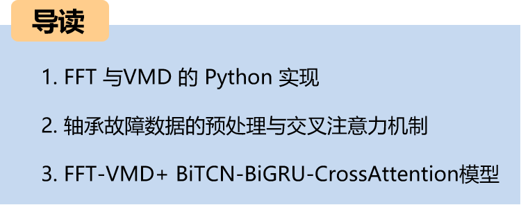
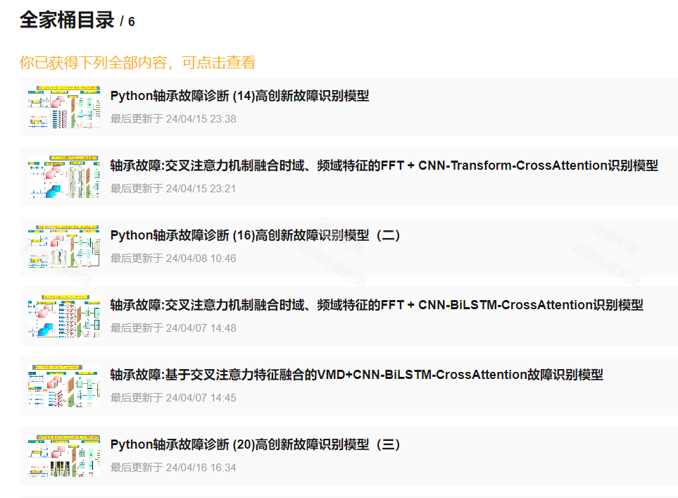
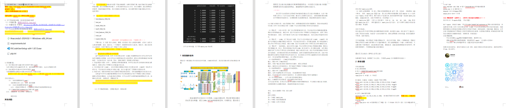
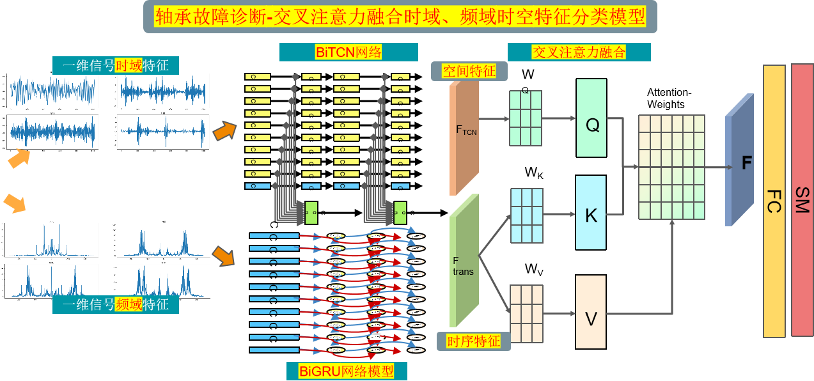
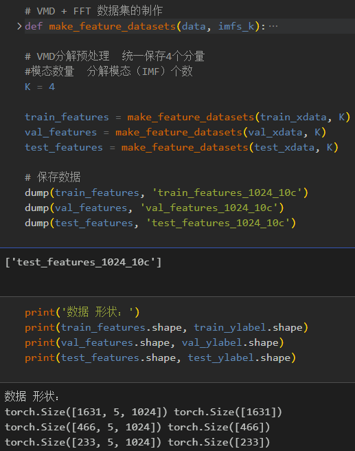
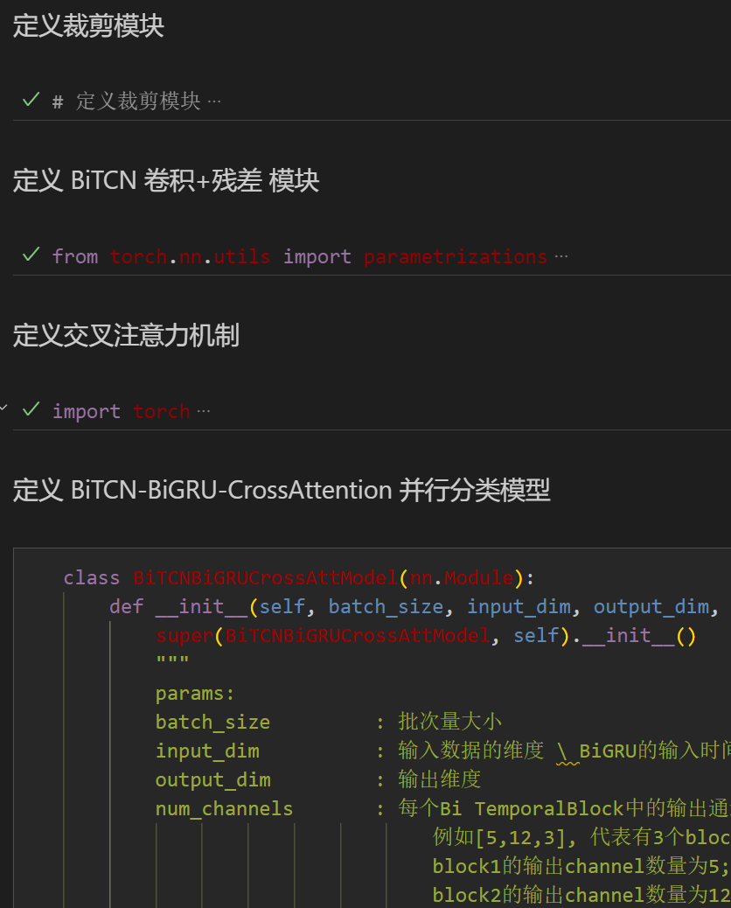
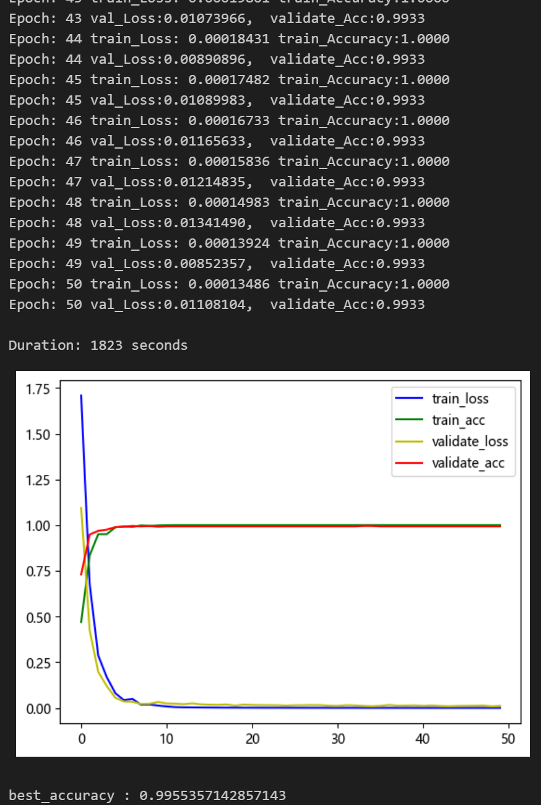
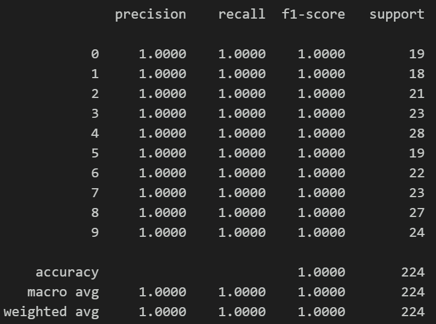
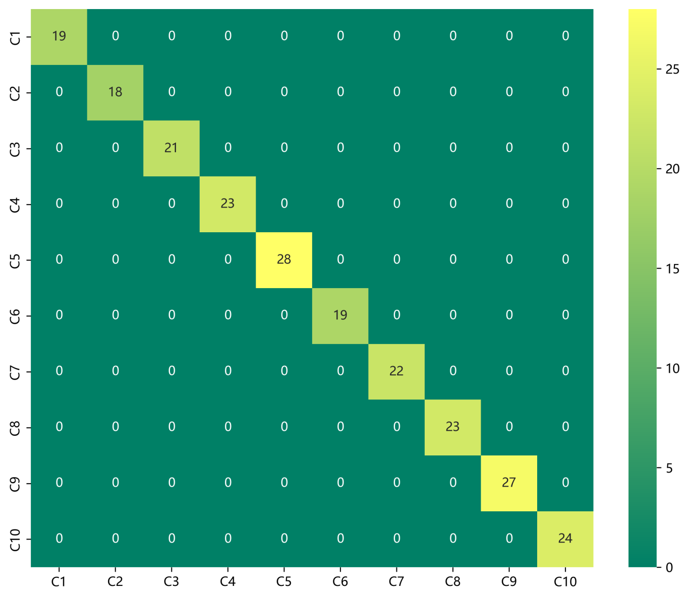
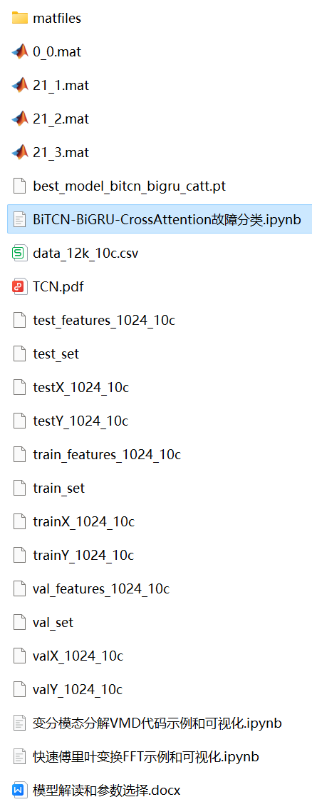

# Python Bearing Fault Diagnosis | Multi-Scale Feature Cross Attention Fusion Model

Recommendation - Family Pack, with higher cost-performance ratio! ● Dataset: Tested, the model achieves 100% classification accuracy on both CWRU West China University bearing dataset and Harbin Institute of Technology Aerospace Engine Bearing Dataset.
● Environment Framework: Python 3.9, PyTorch 1.8 or above are required to run.
● Accuracy: 100% on test set.
● Target Audience: Those who need papers or graduation projects.
● Code Guarantee: The code is detailed with comments, ready to run without modification.
Innovation in the paper!!!
The cross-attention mechanism can model the degree of association between different features, extracting important features for model recognition from fault signal frequency domain and time domain characteristics, which is significantly effective.
Includes a complete bearing fault dataset, as well as generated fault signal datasets, classification data sets, and label sets, all of which can be run, along with examples of FFT-VMD.
50 epochs, 100% accuracy, using FFT-VMD + BiTCN-BiGRU-CrossAttention network for classification, the model can fully extract spatial and temporal features and frequency domain features of bearing fault signals, converges quickly, and has excellent performance, currently the highest precision method among previous articles. Innovation also exists!!!
Includes code for data preprocessing and FFT-VMD + BiTCN-BiGRU-CrossAttention classification.
● Note: We also have accompanying models explanation (helpful for learning network structure) and parameter tuning explanation! For those who need graduation projects or publish small papers, this is essential, with rich modules and high innovation and performance!!
High innovation, noticeable results!! Innovation point:
1. Preprocessing part: Combining Fast Fourier Transform (FFT) and Variational Mode Decomposition (VMD) for signal time-frequency and domain feature extraction, capable of mining multi-scale features in fault signals.
2. Subsequently, the multi-scale features of the fault signal after preprocessing are extracted using the BiTCN network to extract spatial features and the BiGRU to extract time-domain features;
3. Finally, cross attention is used to fuse the spatiotemporal features, thereby enhancing the representation capability of the features to achieve fault signal recognition.
Preface:
This paper is based on bearing data from Case Western Reserve University (CWRU), conducting data preprocessing with Fast Fourier Transform (FFT) and Variational Mode Decomposition (VMD). The classification of fault data is finally realized through a Python-based model that integrates cross attention, BiTCN-BiGRU-CrossAttention for spatiotemporal feature fusion. For a detailed introduction to CWRU bearing data, please refer to the following article:
Python-Case Western Reserve University (CWRU) Bearing Data Interpretation and Classification Processing
1. Overall Model Structure:
\t1.1 The overall structure of the model is as follows:
\tThe one-dimensional fault signals are respectively transformed by FFT and VMD, then the results of the transformation and decomposition are stacked. Through the BiTCN and BiGRU networks, spatial and time-domain features are extracted. Finally, the cross attention mechanism is used to fuse the time-domain and frequency-domain features. By calculating attention weights, the model can focus more on important features, improving model performance and generalization ability.
\t1.2 Innovative Points in detail:
\tWhen processing fault signals, extracting time-frequency domain features is very important. Combining Fast Fourier Transform (FFT) and Variational Mode Decomposition (VMD) can effectively mine multi-scale features from the signal.
\t(1) Preprocessing - FFT:
\tFFT is a widely used method for frequency domain analysis, which can convert signals from the time domain to the frequency domain and obtain the signal's spectrum information. Through FFT, we can obtain the energy distribution of the signal at different frequencies, thereby understanding the frequency components of the signal. However, FFT only provides the signal's spectrum information at a certain moment, unable to reflect the signal's change over time.
1. Preprocessing - VMD:
To address this issue, the Variational Mode Decomposition (VMD) can be introduced. VMD is a mode decomposition method based on signal adaptation, which can decompose signals into a series of mode functions, each representing the characteristics of the signal at different scales. Through VMD, we can obtain the time-domain feature information of the signal at different scales.

2. Preprocessing - Feature Fusion:
Combining FFT and VMD, we can first use FFT to convert the signal to the frequency domain, obtaining the spectrum information of the signal. Then, apply VMD to the faulty signal simultaneously, decomposing it into a series of mode functions. These mode functions represent the time-domain characteristics of the signal at different scales. By analyzing these information, we can mine the multi-scale features of the faulty signal, thereby better understanding the time-frequency characteristics of the signal. This method can analyze signals more comprehensively, aiding in signal processing tasks such as fault detection and diagnosis. We fuse the multi-scale features extracted by FFT and VMD as input to an innovative network model for training.

3. Innovative Network Model - BiTCN Spatial Feature Extraction:
Input: Fused FFT, VMD features
Operation: BiTCN includes two directional convolution operations, used for forward and reverse time-series data respectively. BiTCN utilizes spatial-temporal convolution operations, sliding convolution kernels across both time and space dimensions to acquire feature information at different time points and spatial locations in the sequence data.
Output: Capable of effectively capturing local patterns and global trends in the sequence data.

4. Innovative Network Model - BiGRU Time Series Feature Extraction:
Input: Fused FFT, VMD features
Operation: BiGRU networks learn sequence information, focusing on important time-series features.
Output: The sequential feature representations processed by BiGRU have better fault signal sequential modeling capabilities.
(6) Multi-scale feature fusion - Cross attention mechanism feature fusion:
Input: Spatial features extracted by BiTCN, sequential features extracted by BiGRU
Cross attention mechanism: Use the cross attention mechanism to fuse features in both time and frequency domains. By calculating attention weights, the model can focus more on important features, improving model performance and generalization ability.
2 Preprocessing of bearing fault data
2.1 Import data
Refer to previous articles for preprocessing of fault classification with 10 categories, using the Case Western Reserve University bearing data 10-category dataset:
train_set, val_set, test_set are divided into training set, validation set, and test set according to a ratio of 7:2:1, and finally save the data.
2.2 Fault FFT transformation visualization
2.3 Fault VMD decomposition visualization
2.4 Feature preprocessing dataset for fault data
3 Cross attention mechanism
3.1 Concept of Cross attention
In the Transformer architecture, an attention mechanism that mixes two different embedding sequences is used.
Both sequences must have the same dimensionality.
The two sequences can be different patterns (such as text, sound, image).
One sequence acts as input Q, defining the output sequence length, and another sequence provides input K&V.
3.2 Cross-attention algorithm
With two sequences S1 and S2
Calculate S1's K, V
Calculate S2's Q
Based on K and Q calculate the attention matrix
Apply V to the attention matrix
Output sequence length consistent with S2
During the integration process, we use spatial features extracted by BiTCN temporal-spatial convolution operations as query sequences, and the sequential features output by BiGRU as key-value pair sequences. By calculating the attention weights between the query sequence and the key-value pair sequence, we can model the degree of association between different features.

4. Classification of Bearing Fault Diagnosis Based on FFT-VMD+BiTCN-BiGRU-CrossAttention
4.1 Define the FFT-VMD+BiTCN-BiGRU-CrossAttention classification network model
4.2 Set parameters and train the model
With 50 epochs, an accuracy of 99%, the FFT-VMD+BiTCN-BiGRU-CrossAttention network achieves significant classification results. Fast Fourier Transform (FFT) and Variational Mode Decomposition (VMD) can effectively mine multi-scale features from signals. The innovative model can fully extract spatial and sequential features of bearing fault signals, with fast convergence speed, superior performance, high accuracy, and cross attention mechanism capable of modeling the degree of association between different features. It is able to extract important features from both frequency domain and time domain characteristics of fault signals, resulting in noticeable improvements and a high level of innovation!
Note: Adjust parameters accordingly:
- Increase the number of BiTCN layers and the dimensionality of each layer's channels; adjust learning rate;
- Adjust the number of BiGRU layers and the number of neurons per layer, increasing more epochs (be cautious to prevent overfitting);
- Change the shape of one-dimensional signal stacking (set appropriate length and dimension);
4.3 Model evaluation
- Accuracy, Precision, Recall, F1 Score
- Fault classification confusion matrix:
Previously interesting content:
Python-Kansas State University (CWRU) Bearing Data Interpretation and Classification Process
Python Bearing Fault Diagnosis (I) Short-Time Fourier Transform STFT
Python Bearing Fault Diagnosis (II) Continuous Wavelet Transform CWT
Python Bearing Fault Diagnosis (III) Empirical Mode Decomposition EMD
Pytorch-LSTM Bearing Fault One-Dimensional Signal Classification (I)
Pytorch-CNN Bearing Fault One-Dimensional Signal Classification (II)
Pytorch-Transformer Bearing Fault One-Dimensional Signal Classification (III)
Python Bearing Fault Diagnosis (IV) Fault Classification Based on EMD-CNN
Python Bearing Fault Diagnosis (V) Fault Classification Based on EMD-LSTM
Python Bearing Fault Diagnosis (VI) Fault Classification Based on EMD-Transformer
Python Bearing Fault Diagnosis (VII) Fault Classification Based on EMD-CNN-LSTM
Python Bearing Fault Diagnosis (VIII) Fault Classification Based on EMD-CNN-GRU Parallel Model
FFT + CNN - BiGRU-Attention Fusion of Time and Frequency Features for Bearing Fault Identification Model
FFT + CNN - Transformer Fusion of Time and Frequency Features for Bearing Fault Identification Model
Python Bearing Fault Diagnosis (IX) Fault Classification Based on VMD+CNN-BiLSTM
Python Bearing Fault Diagnosis (X) Fault Classification Based on VMD+CNN-Transformer
Python Bearing Fault Diagnosis (XI) Fault Classification Based on VMD+CNN-BiGRU-Attenion
Cross Attention Fusion of Time and Frequency Features for Bearing Fault Identification Model with VMD + CNN - BiLSTM-CrossAttention
Cross Attention Fusion of Time-Domain and Frequency-Domain Features for Bearing Fault Identification Model with FFT + CNN-Transformer
Introduction to Python Bearing Fault Diagnosis
Python Bearing Fault Diagnosis (13) Super Machine Learning Recognition Model Based on Fault Signal Feature Extraction
Python Bearing Fault Diagnosis (14) Highly Innovative Fault Recognition Model
Python Bearing Fault Diagnosis (15) One-Dimensional Fault Signal Recognition Model Based on CNN-Transformer
Python Bearing Fault Diagnosis (16) Highly Innovative Fault Recognition Model (II)
 | Sci-Tech 1st Class Innovation in Bearing Fault Diagnosis Model!
Python Bearing Fault Diagnosis (18) Innovative Diagnosis Model Based on CNN-TCN-Attention
Based on GADF+Swin-CNN-GAM Highly Innovative Bearing Fault Diagnosis Model
Attention Magic Modification | Super Bearing Fault Diagnosis Model!
Bearing Fault—Innovative Cross Attention Model Full Set
Python Bearing Fault Diagnosis (19) Innovative Diagnosis Model Based on Transformer-BiLSTM
END

## Images

<!-- PAYMENT_BLOCK -->

## Get this dataset

- Payment link (Stripe): [Buy now](https://buy.stripe.com/3cs8yP7sY87d0vu9AB)
- Payment QR code: 

<!-- /PAYMENT_BLOCK -->
